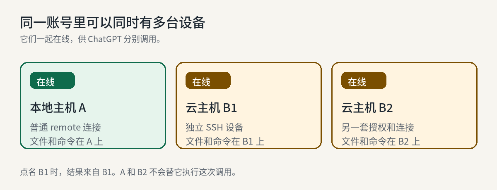
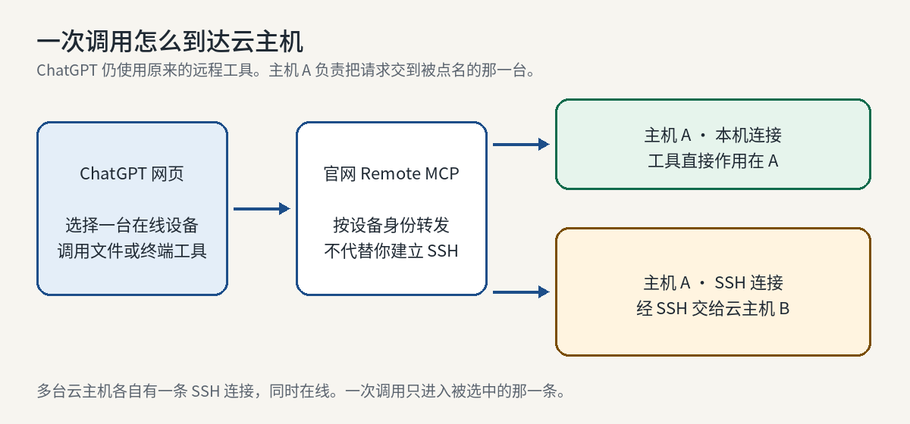
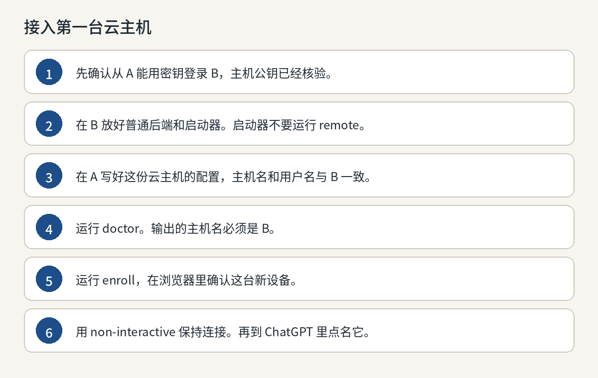
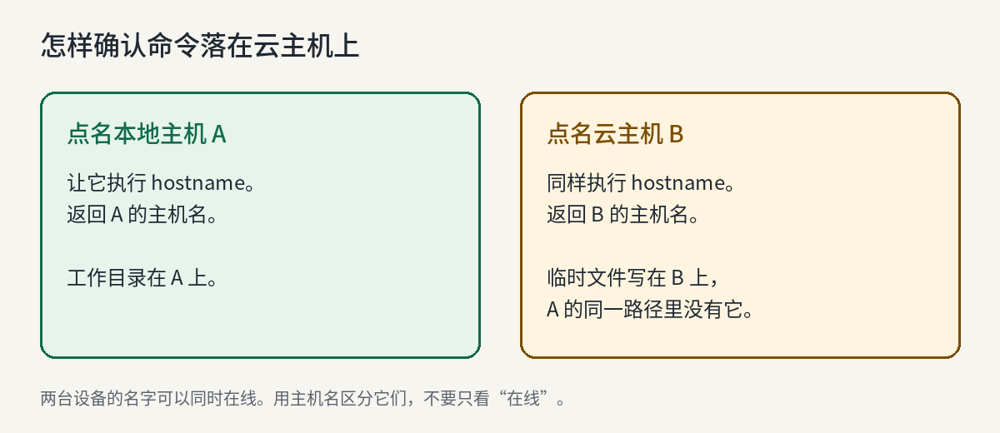
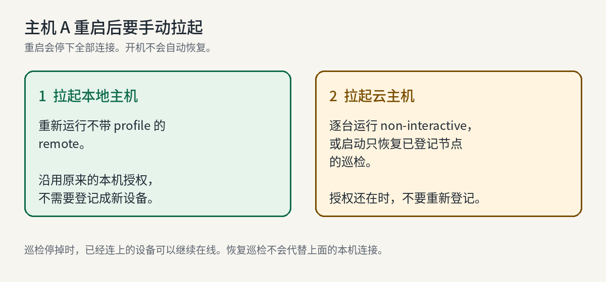

# 用一台 Linux 主机，让 ChatGPT 同时连上多台云服务器

ChatGPT 网页已经可以通过 [Desktop Commander Remote MCP](https://mcp.desktopcommander.app) 控制一台电脑。你在网页里调用读文件、写文件和终端工具时，这些工具作用在当前选中的那台设备上。

这篇说明的是本仓库在此之上补的一层桥接：一台常开的 Linux 主机 A，用 SSH 把另外几台云主机也登记成同一账号里的独立设备。本地主机和多台云主机可以同时在线，ChatGPT 点名哪一台，原来的工具就作用在哪一台。ChatGPT 不需要自己去执行 SSH。

本功能在 fork 的 `feature/ssh-backed-devices` 分支。它还没有合并进上游 `main`，也没有发布成 npm 包。请使用这个分支自己构建，不要用 `npx ...@latest` 来运行这里的 SSH 连接。

原项目是 [wonderwhy-er/DesktopCommanderMCP](https://github.com/wonderwhy-er/DesktopCommanderMCP)，MIT 许可，版权归 Eduard Ruzga 与 Desktop Commander 贡献者。这里保留了上游历史，只增加 SSH 设备这层能力。

## 你最后会看到什么



三台设备可以一起显示为在线：

| 设备 | 谁在维持连接 | 工具作用在哪里 |
|---|---|---|
| 本地主机 A | A 上的普通 remote 连接 | A 自己 |
| 云主机 B1 | A 上这条云主机的 SSH 连接 | B1 |
| 云主机 B2 | A 上另一条 SSH 连接 | B2 |

一次调用只进入被点名的那一台。点名 B1 时，A 和 B2 不会替它执行。这不是把同一句话同时广播到所有机器。

## 请求实际走哪条路



ChatGPT 先把工具调用交给官网的 Remote MCP。官网按设备身份找到主机 A 上对应的连接进程：

- 点名 A 时，A 上的普通连接在本机执行。
- 点名某台云主机时，A 上的 SSH 连接通过已经核验的 SSH，把同一套工具交给那台云主机上的普通后端。

云主机不需要自己登录官网，也不需要运行 `remote`。它只运行普通 Desktop Commander 后端。主机 A 必须保持开机和联网。A 关机后，云主机这些设备也会离线。

这不是图形远程桌面。文件和命令以 SSH 登录的账号权限执行。

## 开始前准备

准备这些东西：

1. 一台可以常开的 Linux 主机，下面称为 A。安装 Node.js 18 或更新版本。使用你自己的 Node 即可，不必替换系统自带的旧版本。
2. 一台或多台 Linux 云主机。A 能用 SSH 密钥登录，主机公钥已经由你本人核验。程序会保持严格的主机密钥检查，不会自动接受新公钥。
3. 同一个可以打开 ChatGPT 网页的账号。按 [mcp.desktopcommander.app](https://mcp.desktopcommander.app) 的说明启用 Remote MCP。
4. 你本人可以在浏览器里确认新设备。确认链接大约 15 分钟内有效，过期后要重新生成，不要复用旧链接。

下面的名字都是占位符：主机 A、云主机 B、profile 名 `node-b`、账号 `dc`。请换成你自己的主机名、用户名和路径。示例配置在 `examples/ssh-device/`，里面的地址不能直接拿去运行。

## 第一步：先让本地主机上线

在 A 上取得这个分支并构建：

```sh
git clone https://github.com/cantbeblank96/DesktopCommanderMCP.git
cd DesktopCommanderMCP
git switch feature/ssh-backed-devices
npm install
npm run build
```

启动本机连接。这条命令没有 `--profile`，控制的是 A 自己：

```sh
node dist/index.js remote
```

第一次运行会给出确认链接。在浏览器中登录并确认，设备列表里会出现主机 A。授权会保存在 A 的 `~/.desktop-commander-device/device.json`。以后重启这条本机连接时，沿用这份授权，不需要登记成另一台设备。

这个文件含有设备凭据。不要把它提交到 Git，也不要复制给云主机使用。

## 第二步：接入第一台云主机



一台云主机对应一份配置、一次浏览器确认、一个长期运行的连接进程。

### 在云主机上放普通后端

把构建好的普通 Desktop Commander 和 Node.js 放到云主机。然后按 `examples/ssh-device/rdc-stdio.example.sh` 写一个启动器，改成云主机上的真实路径，并赋予执行权限。

启动器只运行普通后端，例如 `node .../dist/index.js --no-onboarding`。不要在启动器里加入 `remote`。它的标准输出只留给 MCP 协议，提示信息写到标准错误。无图形界面的云主机可以在启动器里设置：

```sh
export DESKTOP_COMMANDER_SKIP_CHROME_PREFLIGHT=1
export DESKTOP_COMMANDER_EXIT_ON_STDIN_CLOSE=1
export DESKTOP_COMMANDER_DISABLE_TELEMETRY=1
```

第一项跳过启动时的浏览器检查。第二项让 SSH 断开时后端退出，避免留下无人管理的进程。

### 在主机 A 上写连接配置

先确认普通 SSH 可以登录，并且你信任这台云主机的公钥。把 `examples/ssh-device/ssh_config.example` 复制到仓库外面的私有目录，填入真实地址、端口、用户和密钥。保留这些设置：

```text
StrictHostKeyChecking yes
BatchMode yes
IdentitiesOnly yes
ForwardAgent no
```

再复制 `examples/ssh-device/node-b.example.json`。`expectedHostname` 必须等于云主机上 `hostname` 的输出，`expectedUser` 必须等于 `id -un` 的输出。`remoteLauncher` 指向刚才放在云主机上的启动器。

profile 名在这份配置、命令参数和状态目录中是同一个名字。第一台可以就用示例里的 `node-b`。第二台要用另一个名字，例如 `node-c`，并使用另一份配置文件。

### 自检、确认、保持运行

三条命令依次执行：

```sh
# 只检查 SSH、后端和身份，不登录云端
node dist/index.js remote --profile node-b --config /绝对路径/node-b.json --doctor

# 为这台云主机单独授权，成功后退出
node dist/index.js remote --profile node-b --config /绝对路径/node-b.json --enroll

# 使用已经保存的授权持续运行，不再弹出浏览器
node dist/index.js remote --profile node-b --config /绝对路径/node-b.json --non-interactive
```

`doctor` 通过后，输出里的主机名必须是云主机 B。若输出的是 A，先停止，不要继续授权。

`enroll` 会给出新的确认链接。打开它，核对设备名称，只确认自己刚刚发起的那一台。每台云主机都有自己的授权，不能把 A 或其他云主机的 `device.json` 复制过来。

`non-interactive` 是长期运行的连接。终端要保持这个进程，或把它放进你自己的服务管理里。示例服务文件只作参考，仓库不会替你安装系统服务。

## 第三步：在 ChatGPT 里确认落点



本地连接和这台云主机的连接都运行后，网页里应能看到两台在线设备。分别点名它们，让每台执行：

```sh
hostname
```

A 应返回 A 的主机名，B 应返回 B 的主机名。再让 B 在自己的临时目录写一个测试文件，然后到 A 上查看同一路径。文件应在 B 上，A 的同一路径中没有它。共享磁盘上两边都能看见同一个文件时，不能据此判断命令跑在哪一台，要以主机名为准。

看到“在线”只说明连接还在。主机名一致，才能确认点名的是哪一台机器。

## 继续添加其他云主机

对下一台云主机重复第二步：新的 profile 名、新的配置、新的启动器路径、新的一次浏览器确认、新的一个 `non-interactive` 进程。

每台云主机的凭据在：

```text
~/.desktop-commander-device/profiles/<profile名>/
```

不要让两个进程使用同一个 profile。一台云主机的连接还在运行时，不要再启动第二个。

## 连接断开后怎么恢复

先看是哪一种情况，再操作。不要一离线就重新登记。

**连接进程还在，只是云主机暂时连不上。** 进程会自行重试。等云主机恢复后，它会重新接上。此时不要删除锁，也不要再执行一次可能已经生效的写文件或终端命令。一次调用如果已经发出、结果还不确定，重复发送可能让命令执行两遍。

**主机 A 上的连接进程已经退出，授权文件还在。** 先确认这个 profile 没有残留进程，再执行原来的 `non-interactive` 命令。这是恢复原来的设备。授权仍然有效时，不需要新的浏览器确认。

**确认链接过期，或者官网里这台设备已经被撤销。** 再执行一次 `--enroll`，使用新打印出来的链接。旧链接不会重新生效。已经在设备列表里、授权仍有效的机器，不要为了寻找确认按钮而撤销它。

强制结束进程后，可能留下 `instance.lock`。先确认旧进程已经退出，再只处理这个 profile 的残留锁。不要把删除锁写进自动重启脚本，以免两个连接同时使用同一份授权。

## 机器多了以后用巡检

一两台云主机，分别保持 `non-interactive` 进程就够了。机器变多时，可以用仓库里的 `scripts/ssh-fleet.py` 做批量巡检。私有配置从 `examples/ssh-device/fleet.example.json` 复制到仓库外，再填入你核对过的路径和摘要。

巡检只读取一份你事先批准的节点清单，不会执行那份清单脚本。清单内容变化后，要先人工看过新增了哪些机器，再更新配置中的摘要。摘要不一致时，巡检会拒绝开始，这是为了避免悄悄接管新机器。

常用动作：

```sh
# 只查看清单里的机器能否通过 SSH，不修改配置
python3 scripts/ssh-fleet.py --config /绝对路径/fleet.json scan

# 为可达机器准备后端和配置，不给新机器发起授权
python3 scripts/ssh-fleet.py --config /绝对路径/fleet.json sync

# 只为点名的端口发起浏览器授权
python3 scripts/ssh-fleet.py --config /绝对路径/fleet.json authorize --ports 2222

# 每 120 秒检查一次，并只恢复已经登记过的机器
python3 scripts/ssh-fleet.py --config /绝对路径/fleet.json start-watch --registered-only

# 只停止巡检，已经连上的设备继续运行
python3 scripts/ssh-fleet.py --config /绝对路径/fleet.json stop-watch
```

`authorize` 里的端口要换成你清单中的真实端口。已经授权的机器会被跳过。被你手动停止的机器，要先 `resume --ports ...`，巡检才会再启动它。

巡检查询云端设备列表时，使用配置里指定的一台已授权设备做只读查询。先让那台设备的连接运行，再启动巡检。查询失败时，巡检不会登记新设备。

巡检是主机 A 上的一个普通进程。它没有被安装成开机自启。

## 主机 A 重启后



A 重启后，本机连接、各台云主机连接和巡检都会停止，开机不会自动拉起。按这个顺序恢复：

1. 启动本机连接：`node dist/index.js remote`。授权文件还在时，它会回到原来的本地设备。
2. 启动云主机。可以逐台执行原来的 `--non-interactive`；机器较多时，先恢复作为查询锚点的那台，再执行 `start-watch --registered-only`。
3. 回到 ChatGPT，分别让本地主机和一台云主机执行 `hostname`，确认名字和重启前一致。

停掉巡检不会停掉已经连上的设备。恢复巡检也不会代替本机那条不带 profile 的连接，两条都需要运行。

## 使用时记住的边界

- 点名某台云主机时，SSH 或身份检查失败会停在这台云主机。结果不会改由主机 A 执行。
- 云主机的主机名、登录用户或主机公钥发生变化时，连接会停下来等你复核，不会自动改连到另一台。
- 长任务不要只靠这条 SSH 连接续命。连接断开时，不能保证云主机上所有子进程都已经结束。
- 目前这条路径在 Linux 上验证。示例启动器面向 Linux 云主机。
- 凭据、私钥和确认链接只留在你自己的机器上，不要写进仓库、博客或聊天记录。

单台配置的字段说明见 [SSH 设备实现说明](../SSH_DEVICE_IMPLEMENTATION.md)。批量巡检的命令说明见 [SSH 节点批量接入](../SSH_DEVICE_FLEET.md)。
